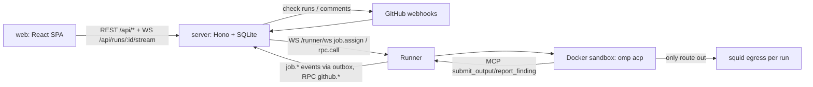

# Repository Guidelines

## Project Overview

Agent Orchestrator runs multi-step AI-agent **flows** (prompt → skill → command → slash command → git commit/push/PR, or PR review → GitHub review) inside hardened Docker sandboxes, with a web UI that streams agent output live.

Glossary:
- **flow**: versioned pipeline definition (zod `FlowDefinition`).
- **run**: one execution of a flow; it has one `run_steps` row per step.
- **runner**: worker host that executes runs.
- **workspace**: git worktree (`local_path`) or PR checkout (`github_checkout`).
- **intervention**: step that pauses the run (`awaiting_input`) for human chat.
- **trust**: `owner` vs untrusted (e.g. fork PRs).

## Architecture & Data Flow

Bun monorepo with four workspaces: `@orch/protocol`, `@orch/server`, `@orch/runner`, `@orch/web`.



- **Run lifecycle**:
  1. Flow stored in `flows` (JSON `definition`).
  2. `createRun.ts:insertRun` creates the run and its pending `runSteps`.
  3. `scheduler.ts` (`kick()` every 5s + on demand) assigns queued runs, oldest first, to the least-loaded eligible runner. Eligibility checks: labels, `maxConcurrentJobs`, `maxConcurrentPerRepo`, trust, and `allowedRoots` containment.
  4. The runner streams `job.events`.
  5. `RunService.ingest` (`runs.ts`) persists into `run_events` and projects into `runs`/`run_steps`/`findings`.
  6. `Hub` (`hub.ts`) fans out to browser subscribers.
- **Wire protocol** (`protocol/src/wire.ts`, `WIRE_PROTOCOL = 3`):
  - Handshake: `hello` → `welcome {lastAckedSeq}` → runner replays its outbox → `replayed`. The server assigns no jobs before `replayed` (`hub.setReplayed`).
  - Events are at-least-once, deduped by `(runId, seq)`, and acked via `job.ack`.
  - The runner re-sends `hello` when capabilities change (skills/commands rescan, gateway models).
- **RPC**:
  - runner→server: `github.token`, `github.createPullRequest`, `github.createComment`. Authorization lives in `server/src/ws/runner.ts:handleRunnerRpc`. Comment targets are resolved server-side, never taken from the runner.
  - server→runner: only `fs.list` (`Hub.rpc`).
- **Runner job** (`runner/src/job.ts:runJob`):
  - Re-validates trust runner-side (`rejectReason`), then loops over steps with a `TemplateContext` (`{{inputs.x}}`, `{{steps.<id>.output}}` via `renderTemplate`).
  - Agent steps run `omp acp` over ACP (`acp-session.ts`). Output and findings come back through the per-run MCP server (`mcp-output.ts`, `/mcp/<runId>`, bearer secret).
- **Sandbox** (`runner/src/sandbox/docker.ts`), per run:
  - Containers/networks: `--internal` network `orch-net-<runId>`, squid `orch-egress-<runId>` (`renderSquidConf` in `sandbox/egress.ts`), run container `orch-run-<runId>`.
  - Hardening: `--cap-drop ALL`, no-new-privileges, tmpfs HOME, host uid.
  - Secrets: passed via `-e NAME` (docker env), never in argv. The gateway bearer is the only secret inside the sandbox; GitHub credentials stay on the server.
- **Retry**: reuses the same run id with a `resumeFrom` cursor. `resumeRunnerId` pins `local_path` runs to the runner that holds the worktree. ACP sessions do not resume; agent steps restart fresh.

## Key Directories

| Path | Purpose |
|---|---|
| `packages/protocol/src` | Pure zod schemas shared by everything: `flow.ts` (Step union, Workspace/Sandbox/Trigger), `events.ts` (`RunEvent`, `RUN_STATUSES`), `wire.ts`, `api.ts` (REST DTOs), `template.ts` |
| `packages/server/src` | `api/` REST routes, `ws/` runner + browser sockets, `github/` (webhook, credentials, checks, report, sanitize), `auth/` (HMAC cookie session, OAuth), `db/` (drizzle schema + migrator) |
| `packages/server/drizzle/` | Generated SQL migrations `0000_init.sql`…; applied automatically at startup |
| `packages/runner/src` | `connection.ts` (WS + backoff + RPC), `outbox.ts` (durable seq'd events), `job.ts`, `acp-session.ts`, `harness/omp.ts`, `sandbox/`, `gateway.ts` (supervises `omp auth-broker`/`auth-gateway`), `mcp-output.ts`, `workspace.ts`, `git.ts`, `fs-rpc.ts`, `library.ts` (skills/commands scan) |
| `packages/web/src` | `main.tsx` (router + QueryClient), `routes/` (Flows, FlowEditor, Runs, RunView, Runners), `components/`, `api.ts`, `ws.ts`, `runState.ts` |
| `docker/sandbox-omp`, `docker/egress` | Sandbox image (debian + sha256-pinned `omp`) and squid egress image |
| `deploy/` | `server.Dockerfile`, `compose.yml` + `Caddyfile`, `orch-runner.service` (systemd), `*.example.json` configs |
| `scripts/build-images.ts` | Builds `orch/sandbox-omp:latest` and `orch/egress:latest` |

## Development Commands

```sh
bun install
bun run images                     # build sandbox + egress Docker images (needs Docker)
echo '{}' > orch.server.json       # server defaults: 127.0.0.1:7800, ./data, auth none
bun packages/server/src/main.ts runner-token create --name laptop [--labels a,b] [--owner <login>]
bun run dev                        # server :7800 (watch), runner, vite :5173
bun run typecheck                  # tsc -p tsconfig.json --noEmit (src, test, scripts)
bun test                           # all tests
bun test packages/server/test/api.test.ts   # single file
bun test -t "flows API"            # filter by name
bun run db:generate                # after editing packages/server/src/db/schema.ts
cd packages/web && bun run build   # web dist served by server at runtime
```

There is no lint or format tooling (no biome/eslint/prettier). Typecheck and tests are the only gates.

## Code Conventions & Common Patterns

- **Validate with zod at every boundary**: config, REST bodies, WS frames (`ServerMessage.safeParse`), and MCP tool args.
  - Unions use `z.discriminatedUnion` on a literal tag (`kind`/`type`/`t`/`method`).
  - Each schema `X` has an inferred type with the same name.
  - Put shared shapes in `@orch/protocol`, never duplicate them per package.
- **API errors**: `{ error: string }` or `{ errors: ["path: message"] }` (`server/src/api/util.ts:issueMessages`). Web `api.ts` throws `ApiRequestError(status, message, errors)`; a 401 redirects to `/auth/login`.
- **Dependency injection**: manual, with no framework.
  - Server: one `AppDeps` interface (`server/src/deps.ts`), built by `createDeps(config, opts)`, consumed by `createApp(deps)`, plus plain classes taking deps in the constructor (`Hub`, `RunService`, `Scheduler`).
  - Runner: composition root in `runner/src/main.ts` wires lambdas (`emit → outbox.append`, `rpc → conn.rpc`) into `JobManager` via `JobDeps`.
  - Swap seams (`SandboxProvider`, injected `fetch` for `GitHubApi`) instead of mocking modules.
- **Persistence**: synchronous `bun:sqlite` + drizzle (`.get()/.all()/.run()`); use `db.transaction(tx => …)` for multi-row invariants. Change the schema only in `db/schema.ts` and then run `db:generate`; never hand-edit `drizzle/meta`.
- **Async**:
  - Patterns in use: `Promise.withResolvers`, `AbortController`/`AbortSignal.timeout`, `Bun.sleep`, `void` for fire-and-forget stream pumps, memoized `??=` promises (e.g. `destroy()`).
  - Reconnects use exponential backoff (1→30s).
  - In the runner, only the outbox is durable; plain `send()` is lossy.
- **Naming**:
  - Files: kebab-case in runner/server (`acp-session.ts`, `fs-rpc.ts`); PascalCase React components and routes.
  - Classes: `XService`, `XManager`, `XProvider`.
  - Timeout/limit constants: `SCREAMING_SNAKE` (`RUNNER_LOST_MS`).
  - Ids: ULIDs. Timestamps: epoch ms.
- **Imports**: extensionless relative imports (`./api/flows`), `node:` prefix for builtins, `import type` for type-only imports.
- **Logging**: `console.*` with a module prefix: `[scheduler] …`, `[runner ${id}] …`. There is no logger library. Errors are turned into strings with `err instanceof Error ? err.message : String(err)` (`errorText` in `runner/src/job.ts`, `errorMessage` in `web/src/api.ts`).
- **State**:
  - Server: authoritative state in SQLite; in-memory `Hub` only for live fan-out.
  - Web: TanStack Query for REST state; a pure reducer `applyRunEvent` (`runState.ts`) folds `RunEvent`s for the run view. Keep it pure, because it must stay replay- and dedupe-safe.
- **Comments**: explain *why*, especially protocol contracts and security constraints. Keep that style.
- **Security invariants (do not weaken)**:
  - Untrusted runs: no `local_path` workspace, no action steps, no `approval: ask`, no open network. These are checked on both server and runner.
  - PR title/body are wrapped in `<untrusted_pr_text>`; comments go through `neutralizeMentions`.
  - Runner paths must pass `allowedRoots` (realpathed); mount paths go through `assertMountPath`.
  - WS close codes: 4401 unauthorized, 4403 bad Origin, 4404 not found, 4409 replaced connection.

## Important Files

- Entry points: `packages/server/src/main.ts` (`serve` | `runner-token create`), `packages/runner/src/main.ts`, `packages/web/src/main.tsx`.
- Wiring: `packages/server/src/app.ts`. WS routes are registered **before** REST so `/api/runs/:id/stream` isn't shadowed; the `*` fallback serves `packages/web/dist`.
- Config parsing:
  - `packages/server/src/config.ts`: `ORCH_SERVER_CONFIG`, default `./orch.server.json`; a missing file means all defaults; relative paths resolve against the config file's directory; `auth.mode:"github"` requires `github.kind:"app"`.
  - `packages/runner/src/config.ts`: `ORCH_RUNNER_CONFIG`, default `~/.agent-orchestrator/runner.json`.
- Example configs: `deploy/orch.server.example.json`, `deploy/runner.example.json`, `deploy/runner.laptop.example.json`. Local `orch.server.json` / `orch.runner.json` are gitignored and may hold secrets; never commit or print them.
- `packages/web/vite.config.ts`: dev proxy for `/api` and `/auth` (rewrites Origin to the server's), plus regex key `^/runner/ws$` so the `/runners` SPA route isn't proxied.
- `data/orch.sqlite`: live local DB (~640 MB). Never read, modify, or commit it.

## Runtime/Tooling Preferences

- **Bun ≥ 1.4 only**: runtime, package manager (`bun.lock`), test runner, and script runner. Use `bun`/`bunx`, never npm/pnpm/node.
  - Runner code relies on `Bun.spawn`, `Bun.serve`, and Bun's `WebSocket` headers option (cast in `connection.ts`).
- TypeScript 7 (`tsc` is typecheck only, `noEmit`). `module: Preserve`, `moduleResolution: bundler`, `strict`, `jsx: react-jsx`, `types: ["bun"]`. Bun runs the TS directly; Vite bundles the web app.
- Web stack: React 19, react-router 7, TanStack Query 5, `@xyflow/react`, plain CSS (`styles.css`, utility-ish classes like `row gap`, `btn small`, `muted`).
- External requirements: Docker, and an `omp` CLI that is logged in for the runner. Run `bun run images` before running jobs.
- Deploy:
  - Server: `orch/server` image behind Caddy (`deploy/compose.yml`, env `ORCH_DOMAIN`).
  - Runners: run bare on hosts via systemd. `hostBind` must be reachable from containers (docker bridge IP on Linux).

## Testing & QA

- Framework: `bun:test` (`describe/test/expect`). Tests live in `packages/<pkg>/test/*.test.ts` and mirror `src/` names (`outbox.test.ts` ↔ `src/outbox.ts`). They import `../src/...`.
- No coverage config or threshold. Add tests for behavior changes in protocol, scheduler, run projection, wire handling, and sandbox config.
- Isolation patterns to reuse:
  - **Server**: `packages/server/test/helpers.ts`.
    - `testDeps()` builds `createDeps` over `createDb(":memory:")`.
    - HTTP goes through `createApp(deps)` + `app.request()` (no listener).
    - Other helpers: `flowDef()`, `addRunner`, `connectRunner` (attaches a `FakeLink` and marks it replayed), `addRun`.
  - **GitHub**: inject a fake `fetch` into `new GitHubApi(fetch, "https://gh.test", …)`. Never hit real network.
  - **Runner**:
    - `FakeSandboxProvider implements SandboxProvider` (Docker is never invoked in tests).
    - Scripted ACP agent `test/fixtures/fake-agent.ts`: prompt keywords `write`, `slow`, `ask`, `read`, `echo`.
    - `test/fixtures/fake-print.ts` for headless `omp -p`.
  - **WS**: real loopback `Bun.serve({ port: 0, hostname: "127.0.0.1" })`.
  - **FS**: `mkdtempSync(join(tmpdir(), "x-"))` + `rmSync(..., { recursive: true, force: true })` in before/after hooks.
- Web tests cover pure logic only (`runState.test.ts`, `checkoutCommand.test.ts`). For UI changes, check the real UI via `bun run dev` → http://localhost:5173.
- Before finishing: run `bun run typecheck` and `bun test`.
